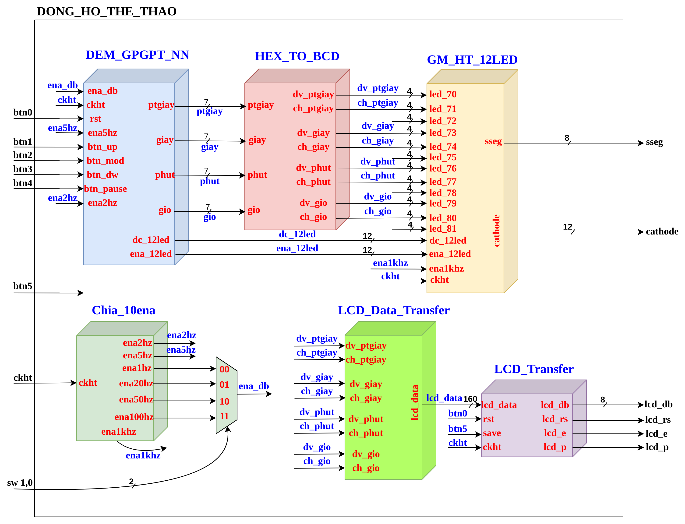
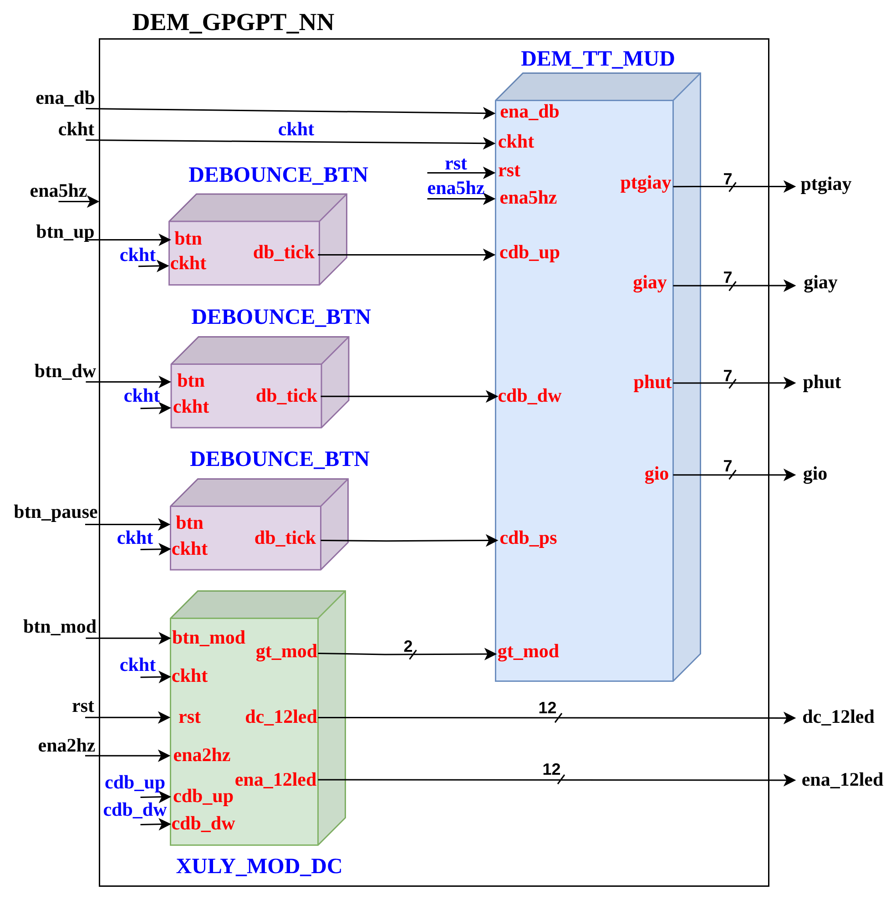
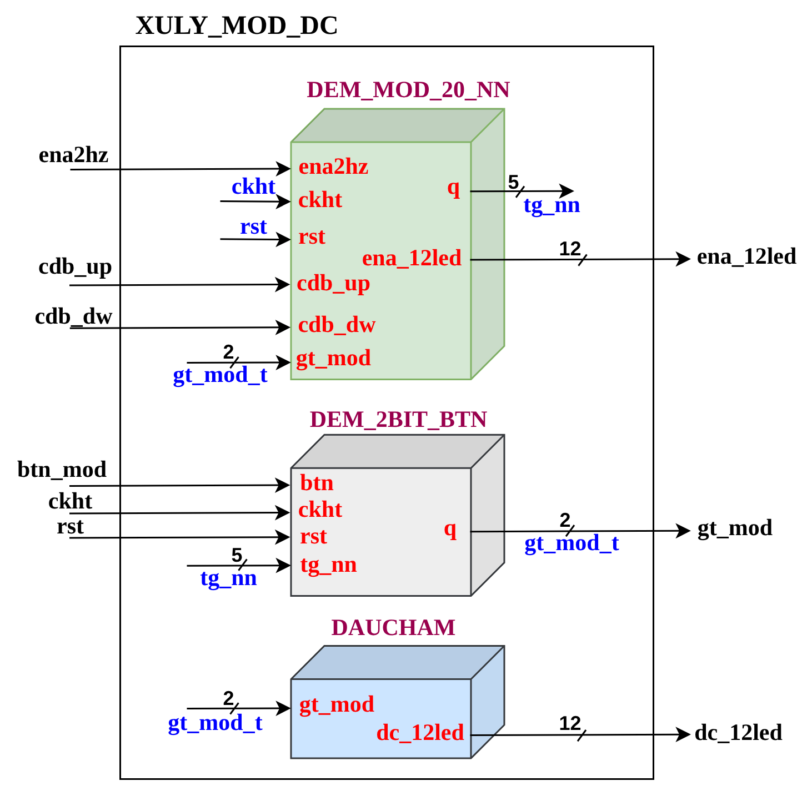
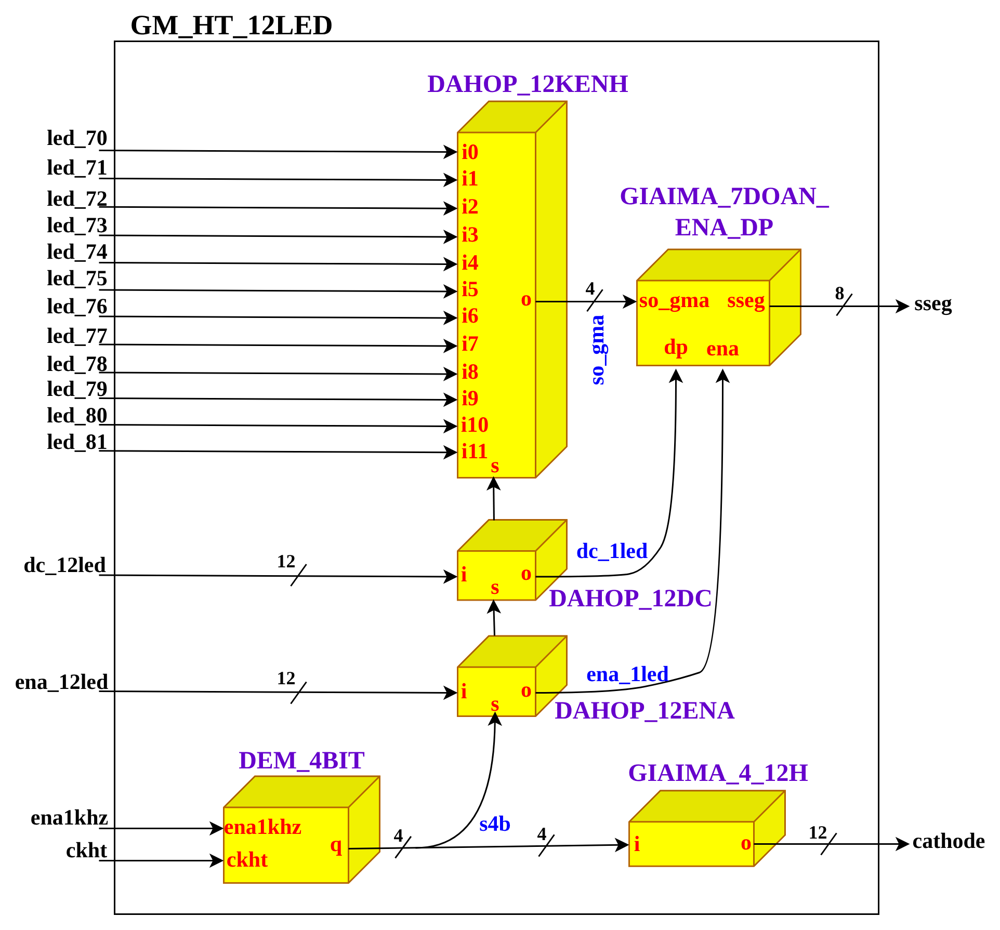
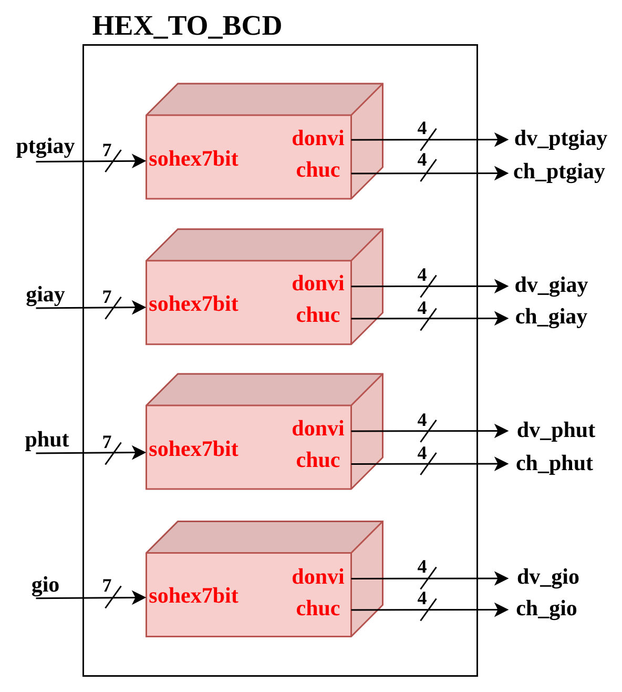
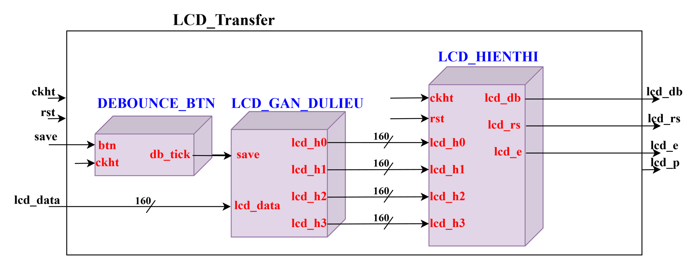

# Multifunctional Sports Stopwatch on FPGA

A digital sports stopwatch implemented in Verilog on an **Arty Z7 (Xilinx Zynq-7020)** board, with **10 ms resolution**, lap saving, pause/resume and manual time adjustment. Output goes to both a **scanned 12-digit seven-segment display** and a **20×4 character LCD**.

> Course project — Logic Design, Computer Engineering, HCMUT.

---

## Overview

The design is built as a hierarchy of small, single-purpose modules rather than one large state machine. Every module has an explicit port list, and every bus in the block diagrams carries its width, so the diagrams match the RTL port-for-port.

The hierarchy is **four levels deep** with around twenty distinct modules, and reuses `DEBOUNCE_BTN` across four places.

**Top-level interface**

| Signal | Width | Direction | Role |
|---|---|---|---|
| `ckht` | 1 | in | System clock |
| `btn0` | 1 | in | Reset |
| `btn1` / `btn3` | 1 | in | Adjust up / down |
| `btn2` | 1 | in | Mode select |
| `btn4` | 1 | in | Pause / resume |
| `btn5` | 1 | in | Save lap |
| `sw[1:0]` | 2 | in | Debounce rate select |
| `sseg` | 8 | out | Seven-segment data |
| `cathode` | 12 | out | Seven-segment digit scan |
| `lcd_db` | 8 | out | LCD data bus |
| `lcd_rs`, `lcd_e`, `lcd_p` | 1 | out | LCD control |

---

## Top-level architecture



Six modules at the top level:

| Module | Role |
|---|---|
| `Chia_10ena` | Clock divider — generates `ena2hz`, `ena5hz`, `ena1hz`, `ena20hz`, `ena50hz`, `ena100hz`, `ena1khz` |
| `DEM_GPGPT_NN` | Main time counter — hundredths, seconds, minutes, hours |
| `HEX_TO_BCD` | Splits each 7-bit time field into two BCD digits |
| `GM_HT_12LED` | Scanned seven-segment display driver |
| `LCD_Data_Transfer` | Packs BCD digits into LCD character data |
| `LCD_Transfer` | LCD controller driver |

**One design decision worth calling out:** the debounce clock is not fixed. `Chia_10ena` produces several enable rates and a 4:1 multiplexer selected by `sw[1:0]` picks which one feeds `ena_db` — 1 Hz, 20 Hz, 50 Hz or 100 Hz. That makes debounce sensitivity tunable at runtime without resynthesising, which is useful when the same bitstream has to work with different push-button hardware.

---

## Module hierarchy

```
DONG_HO_THE_THAO
├── Chia_10ena                      clock divider + debounce-rate mux
├── DEM_GPGPT_NN                    time counter
│   ├── DEBOUNCE_BTN  ×3            up / down / pause
│   ├── XULY_MOD_DC                 mode and decimal-point handling
│   │   ├── DEM_MOD_20_NN
│   │   ├── DEM_2BIT_BTN
│   │   └── DAUCHAM
│   └── DEM_TT_MUD                  counter core
├── HEX_TO_BCD
│   └── sohex7bit     ×4            one per time field
├── GM_HT_12LED                     seven-segment scan driver
│   ├── DAHOP_12KENH                12:1 segment mux
│   ├── DAHOP_12DC                  12:1 decimal-point mux
│   ├── DAHOP_12ENA                 12:1 digit-enable mux
│   ├── GIAIMA_7DOAN_ENA_DP         BCD → seven-segment decoder
│   ├── GIAIMA_4_12H                4 → 12 digit-select decoder
│   └── DEM_4BIT                    scan counter
├── LCD_Data_Transfer
└── LCD_Transfer
    ├── DEBOUNCE_BTN                lap-save button
    ├── LCD_GAN_DULIEU              builds four 160-bit display lines
    └── LCD_HIENTHI                 LCD timing and transfer
```

---

## Time counter — `DEM_GPGPT_NN`



Three `DEBOUNCE_BTN` instances filter the up, down and pause buttons before anything downstream sees them. `XULY_MOD_DC` handles mode selection and the decimal-point pattern; `DEM_TT_MUD` is the counter core, producing four 7-bit fields (`ptgiay`, `giay`, `phut`, `gio`) plus the 12-bit decimal-point and digit-enable vectors.

### Mode and decimal point — `XULY_MOD_DC`



`DEM_2BIT_BTN` turns mode-button presses into a 2-bit mode code; `DEM_MOD_20_NN` applies it; `DAUCHAM` maps the mode to the 12-bit decimal-point mask so the display shows the right separators for the current mode.

---

## Seven-segment driver — `GM_HT_12LED`



`DEM_4BIT`, a 4-bit scan counter clocked by `ena1khz`, drives three parallel 12:1 multiplexers — one for the digit value, one for the decimal point, one for the digit enable. The selected digit goes through `GIAIMA_7DOAN_ENA_DP` to produce `sseg[7:0]`, while `GIAIMA_4_12H` expands the scan index into the 12-bit `cathode` select.

Scanning at 1 kHz means each of the twelve digits is refreshed about 83 times per second — above the flicker threshold.

---

## BCD conversion — `HEX_TO_BCD`



Four identical `sohex7bit` instances, one per time field. Each takes a 7-bit binary value and splits it into tens (`chuc`) and units (`donvi`), 4 bits each.

---

## LCD path — `LCD_Transfer`



`LCD_GAN_DULIEU` assembles four 160-bit lines — 20 characters × 8 bits each, matching the 20×4 display — and `LCD_HIENTHI` drives the LCD's power-on initialization sequence and the data/command transfer protocol on `lcd_db`, `lcd_rs`, `lcd_e` and `lcd_p`.

---

## Diagram source

The complete block diagram is in [`docs/00-full-diagram.svg`](docs/00-full-diagram.svg), drawn in [diagrams.net](https://app.diagrams.net). The PNGs above are cropped panels from it. Open the SVG to see every level on one canvas.

---

## Repository structure

```
.
├── docs/           Block diagrams (SVG source + cropped panels)
├── src/            Verilog source
└── README.md
```
